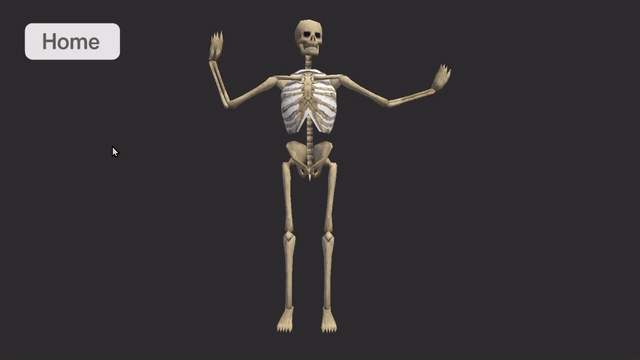
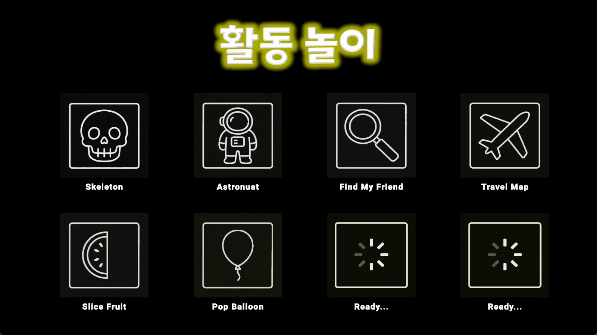
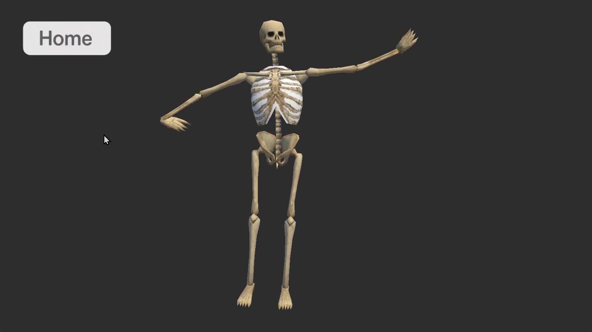
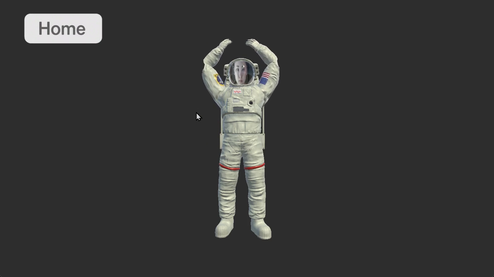
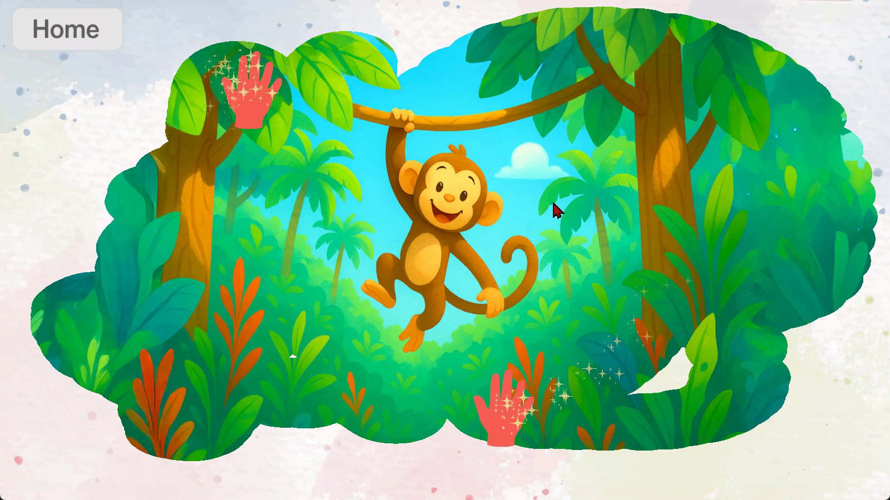
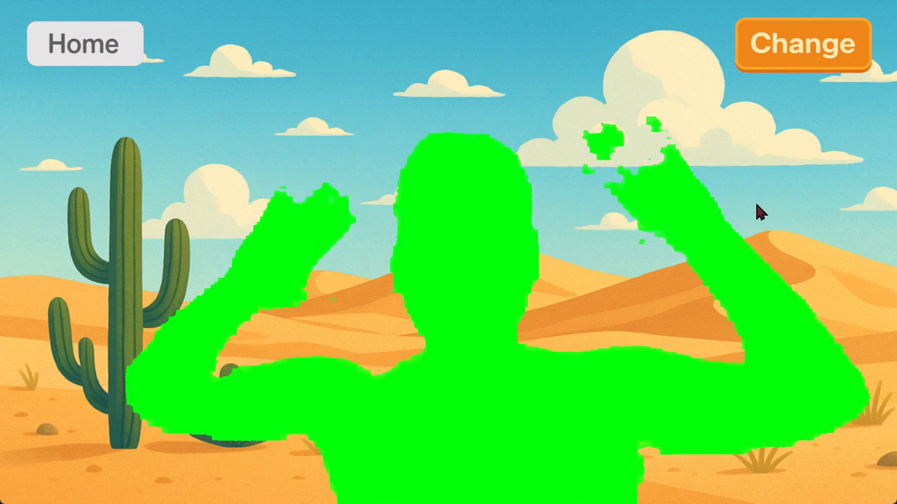

# mediapipeTracingProject

단일 RGB 웹캠 입력으로 전신 포즈·손·인물 영역을 실시간 추적하고, 그 결과를 Unity 3D 캐릭터 리타기팅과 화면 상호작용에 적용한 모션 트래킹 인터랙션 프로젝트입니다.



## Overview

| 항목 | 내용 |
|---|---|
| 분야 | Vision-based Motion Tracking, Real-time Interaction |
| 엔진 | Unity 6 (6000.0.59f2), C# |
| 비전 | MediaPipe Unity Plugin — Pose Landmarker, Hand Landmarker, Image Segmentation |
| 입력 | 단일 RGB 웹캠 (별도 센서 없음) |
| 플랫폼 | Windows, Android (전면 카메라) |

## Modules

| 모듈 | 기능 | 핵심 기술 |
|---|---|---|
| Skeleton | 사용자 전신 자세를 Humanoid 캐릭터에 실시간 반영 | 33개 포즈 랜드마크 → Humanoid 본 리타기팅 |
| Astronaut | 상반신 동작 리타기팅 + 헬멧 바이저에 얼굴 영역 합성 | 관절 각도 제한, 얼굴 랜드마크 기반 자동 크롭 |
| Find My Friend | 손 위치로 화면 마스크를 지워 숨은 이미지 노출 | 손 랜드마크 → UV 변환, 렌더 텍스처 마스크 브러시 |
| Travel Map | 인물 영역을 분리해 가상 배경 위에 합성, 손 터치로 배경 전환 | 인물 분할 마스크 합성, 손 좌표 히트 판정 |
| Slice / Balloon | 손 궤적과 오브젝트 충돌 판정, 점수 처리 (개발 중) | 손 궤적 충돌 판정, 파티클 이펙트 |

## Technical Implementation

- **포즈 리타기팅**: 정규화 랜드마크를 본 방향 벡터로 변환하고, 바인드 포즈 오프셋 캐싱과 지수 이동 평균(EMA) 필터로 지터를 억제. 관절별 회전 제한으로 비정상 자세 방지
- **하체 처리**: 상반신만 촬영되는 환경을 위해 하체 고정 및 절차적 보행(Procedural Walk) 옵션 제공, 발끝 본 고정 후처리
- **마스크 브러시**: 손 좌표를 텍스처 UV로 변환해 렌더 텍스처에 스탬프, 이동 임계값 기반 스탬프 간격 제어, 일정 시간 후 자동 초기화
- **인물 분할 합성**: 분할 마스크에 임계값·페더링을 적용해 경계 품질 개선, 카메라 미연결 시 대체 배경 표시
- **카메라 처리**: 장치 지정 웹캠 초기화, 내부 렌더 해상도 고정, 좌우 반전 토글, Android 전면 카메라 부트스트랩

## Extension

- **Hand Tracking 3D Interaction (Prototype)**: 동일한 트래킹 파이프라인을 3D 조리 환경에 연동해, 21개 손 랜드마크를 화면 좌표로 매핑하고 멀티 카메라 시점 전환을 구현한 확장 프로토타입

## Scripts

| 경로 | 내용 |
|---|---|
| `Skeleton/` | 포즈 데이터 공급 인터페이스, Humanoid 리타기팅(`PoseToHumanoid`), 카메라 자동 프레이밍 |
| `ScriptsAsstron/` | 우주인 리타기팅(`PoseToAstronaut`), 절차적 보행, 발끝 고정, 얼굴 크롭·바이저 출력 |
| `EraseMap/` | 손 기반 마스크 브러시(`HandEraserController`) |
| `ChangeMap/` | 인물 분할 배경 합성(`SegmentationCompositeBinder`) |
| `Slice/` | 손 궤적 충돌 판정, 이펙트, 점수 관리 |
| `Main/`, 루트 | 씬 전환, 카메라 반전, 애플리케이션 종료 |
| `Editor/` | Skinned Mesh 정리용 에디터 도구 |

## Repository Structure

```
Scripts/   직접 작성한 C# 스크립트 (MediaPipe 플러그인 코드 제외)
media/     스크린샷, 미리보기 GIF
```

## Screenshots

| 메인 메뉴 | Skeleton | Astronaut |
|---|---|---|
|  |  |  |

| Find My Friend | Travel Map |
|---|---|
|  |  |
